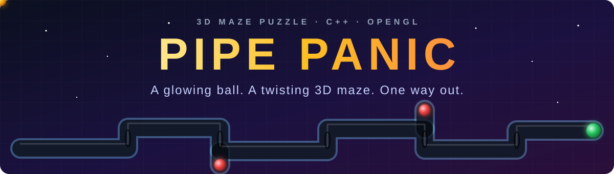
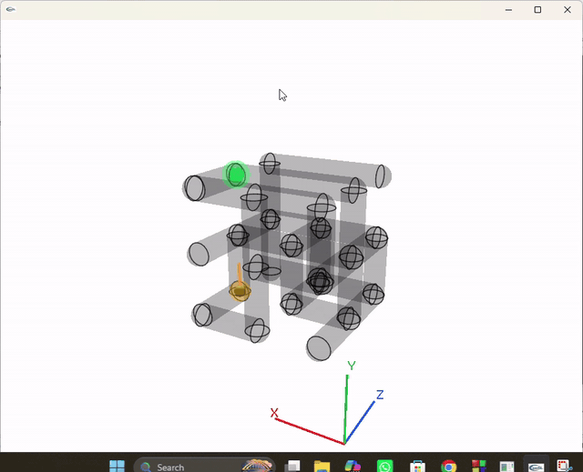
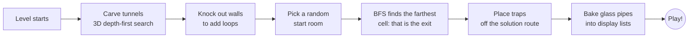

<div align="center">



<br>


[](https://github.com/Sohom57/Pipe-Panic/stargazers)

<br>

[](https://github.com/Sohom57/Pipe-Panic/archive/HEAD.zip)

**[Watch](#demo) · [Play](#play) · [Controls](#controls) · [How to play](#howto) · [Difficulty](#difficulty) · [Under the hood](#tech) · [Build](#build) · [FAQ](#faq)**

</div>

---

## Why you will love it

<table>
  <tr>
    <td align="center" width="33%">
      <h3>🧊 Smoked-glass pipes</h3>
      <sub>See straight through the maze. Rings mark every turn, junction and dead end.</sub>
    </td>
    <td align="center" width="33%">
      <h3>🎲 Endless fresh mazes</h3>
      <sub>Every level is carved in 3D from scratch and always has a way out.</sub>
    </td>
    <td align="center" width="33%">
      <h3>📈 Difficulty that grows</h3>
      <sub>Bigger mazes, more traps and fewer shortcuts, one small step per level.</sub>
    </td>
  </tr>
  <tr>
    <td align="center">
      <h3>🎥 Full 3D control</h3>
      <sub>Move on X, Y and Z. Rotate the maze on any axis. Orbit and zoom the camera.</sub>
    </td>
    <td align="center">
      <h3>✨ Glow and trail</h3>
      <sub>A golden ball with a glowing trail, a pulsing green exit and red hazard orbs.</sub>
    </td>
    <td align="center">
      <h3>🛡️ Forgiving traps</h3>
      <sub>Fall into a trap and you restart the same maze. You never lose your level.</sub>
    </td>
  </tr>
</table>

---

<a id="demo"></a>
## Gameplay

<div align="center">

<a href="assets/demo.mp4">
  
</a>

<sub>Click the preview to open the full-quality video.</sub>

</div>

---

<a id="play"></a>
## Play in 60 seconds

| Step | What to do |
|:---:|---|
| **1** | **[Download the ZIP](https://github.com/Sohom57/Pipe-Panic/archive/HEAD.zip)** or clone `Sohom57/Pipe-Panic`. |
| **2** | Extract it anywhere. |
| **3** | Run **`bin/Debug/Khela.exe`** and start rolling. |

> [!IMPORTANT]
> Keep `glut32.dll` in the same folder as `Khela.exe`. It is already included in `bin/Debug/`. If you move the game, move the DLL with it.

---

<a id="controls"></a>
## Controls

Hold a key to keep moving. Movement and rotation both run smoothly while the key is held.

### Keyboard map

```text
        MOVE THE BALL                          ROTATE THE MAZE

  ┌─────┐ ┌─────┐ ┌─────┐                ┌─────┐ ┌─────┐ ┌─────┐
  │  Q  │ │  W  │ │  E  │                │  U  │ │  I  │ │  O  │
  │ -Y  │ │ -Z  │ │ +Y  │                │ Z+  │ │ X+  │ │ Z-  │
  └─────┘ └─────┘ └─────┘                └─────┘ └─────┘ └─────┘
  ┌─────┐ ┌─────┐ ┌─────┐                ┌─────┐ ┌─────┐ ┌─────┐
  │  A  │ │  S  │ │  D  │                │  J  │ │  K  │ │  L  │
  │ -X  │ │ +Z  │ │ +X  │                │ Y+  │ │ X-  │ │ Y-  │
  └─────┘ └─────┘ └─────┘                └─────┘ └─────┘ └─────┘

     CAMERA            ZOOM                       GAME
  ┌───┐┌───┐┌───┐   ┌───┐ ┌───┐      N  new maze        1  Easy start
  │ ← ││ ↑ ││ → │   │ + │ │ - │      R  retry level     2  Medium start
  └───┘└───┘└───┘   └───┘ └───┘      T  reset view       3  Hard start
       ┌───┐        PgUp / PgDn       Esc quit
       │ ↓ │
       └───┘
```

<details open>
<summary><b>🔵 Move the ball</b></summary>
<br>

| Keys | Direction | Axis arrow colour |
|:---:|---|:---:|
| <kbd>A</kbd> / <kbd>D</kbd> | Left / Right (-X / +X) | 🔴 X |
| <kbd>Q</kbd> / <kbd>E</kbd> | Down / Up (-Y / +Y) | 🟢 Y |
| <kbd>W</kbd> / <kbd>S</kbd> | Away / Towards (-Z / +Z) | 🔵 Z |

The ball moves along the **maze's own axes**, not the screen's. Rotating the maze never changes what a key does. Follow the red, green and blue axis arrows in the corner of the maze to stay oriented.

</details>

<details open>
<summary><b>🟠 Rotate the maze</b></summary>
<br>

| Keys | Action |
|:---:|---|
| <kbd>I</kbd> / <kbd>K</kbd> | Rotate around the **X** axis |
| <kbd>J</kbd> / <kbd>L</kbd> | Rotate around the **Y** axis |
| <kbd>U</kbd> / <kbd>O</kbd> | Rotate around the **Z** axis |
| <kbd>T</kbd> | Reset rotation and camera |

</details>

<details open>
<summary><b>🟣 Camera and zoom</b></summary>
<br>

| Keys | Action |
|:---:|---|
| <kbd>←</kbd> / <kbd>→</kbd> | Orbit the camera left / right |
| <kbd>↑</kbd> / <kbd>↓</kbd> | Orbit the camera up / down |
| <kbd>+</kbd> / <kbd>-</kbd> | Zoom in / out |
| <kbd>Page Up</kbd> / <kbd>Page Down</kbd> | Zoom in / out |

</details>

<details open>
<summary><b>🟢 Game</b></summary>
<br>

| Key | Action |
|:---:|---|
| <kbd>1</kbd> | Start a new game on **Easy** |
| <kbd>2</kbd> | Start a new game on **Medium** |
| <kbd>3</kbd> | Start a new game on **Hard** |
| <kbd>N</kbd> | Build a **new maze** at the current level |
| <kbd>R</kbd> | **Retry** the current maze from the start |
| <kbd>Esc</kbd> | Quit |

</details>

---

<a id="howto"></a>
## How to play

Roll the golden ball through the glass pipes and touch the green gem. Each exit takes you to a bigger, trickier maze.

| You see | What it is |
|:---:|---|
| 🟡 **Gold ball** with an orange trail | You |
| 🟢 **Pulsing green gem** | The exit. Touch it to move to the next level |
| 🔴 **Pulsing red orb** | A trap. Touch it and you restart the same maze after a short pause |
| ⚫ **Smoked-glass pipe** | The tunnels. Rings mark turns, junctions and dead ends |
| 🔴🟢🔵 **X / Y / Z arrows** | Axis guide in the maze corner |

<details>
<summary><b>💡 Pro tips</b></summary>
<br>

- **Turning corners is forgiving.** The ball gently re-centres itself in the pipe. Release the key, then press the new direction.
- **Traps never block the solution.** They only sit in side branches and dead ends, so if a route is full of red orbs, try another one.
- **Rotate to read the maze.** Use <kbd>I</kbd> <kbd>J</kbd> <kbd>U</kbd> and friends to look down a long pipe before committing.
- **Zoom out on big mazes.** Tap <kbd>-</kbd> to see the whole structure, then zoom in for tight spots.
- **Stuck in a loop?** Press <kbd>N</kbd> for a brand new maze at the same level.

</details>

---

<a id="difficulty"></a>
## Difficulty and progression

Every level is one small step harder than the last. The maze grows every two levels, traps appear gradually, and shortcuts slowly disappear.

| Level (from Easy) | Maze size | Traps | Shortcut loops |
|:---:|:---:|:---:|:---:|
| 1 | 7 × 7 × 7 | 0 | 10 |
| 2 | 7 × 7 × 7 | 0 | 9 |
| 3 | 9 × 9 × 9 | 1 | 8 |
| 4 | 9 × 9 × 9 | 2 | 7 |
| 5 | 11 × 11 × 11 | 2 | 6 |
| 6 | 11 × 11 × 11 | 3 | 5 |
| 7 | 13 × 13 × 13 | 4 | 4 |
| 8 | 13 × 13 × 13 | 4 | 3 |
| 9+ | 13 × 13 × 13 | 5 up to 10 | 2 |

Pressing <kbd>1</kbd> <kbd>2</kbd> <kbd>3</kbd> simply picks where on this ladder you begin:

| Start | Begins at | Feels like |
|:---:|:---:|---|
| <kbd>1</kbd> Easy | Level 1 | A gentle warm-up with no traps |
| <kbd>2</kbd> Medium | Level 5 | A mid-sized maze with a few traps |
| <kbd>3</kbd> Hard | Level 9 | The biggest maze with plenty of traps |

The ball also gets slightly faster as you climb, up to a cap.

---

<a id="tech"></a>
## Under the hood

Pipe Panic is built with plain C++ and legacy OpenGL through GLUT. There are no game engines and no model files. Every mesh is generated with `cos()` and `sin()`.



| Feature | How it works |
|---|---|
| **Maze generation** | A randomised 3D depth-first search digs tunnels between rooms, so every room is connected. Extra walls are removed to create loops. |
| **Fair exits and traps** | A breadth-first search from the start picks the farthest cell as the exit, then keeps traps off the shortest route so every level is solvable. |
| **Smoked glass** | Parametric cylinders and joint spheres, drawn with alpha blending and depth writes off, with two-sided lighting and specular highlights. |
| **Clean joints** | Each joint sphere skips the patches that face open pipes, so elbows and T-junctions meet without membranes inside the tunnel. |
| **Collision** | Axis-by-axis AABB tests, so the ball slides along the pipe wall instead of sticking. |
| **Smooth control** | Held-key tracking with a gentle centring assist makes tight corners easy. |
| **Fast rendering** | The static pipes are compiled into display lists once per level. |

---

<a id="build"></a>
## Build from source

<details>
<summary><b>🛠️ Code::Blocks step by step</b></summary>
<br>

1. Install **Code::Blocks 17.12** with the **MinGW GCC** toolchain.
2. Make sure the GLUT headers and libraries are installed for MinGW.
3. Open **`Khela.cbp`**.
4. In **Project → Build options → Linker settings**, add:

   | Library set | Link these |
   |---|---|
   | GLUT 3.7 (`glut32.dll`) | `glut32` `glu32` `opengl32` |
   | freeglut | `freeglut` `opengl32` `glu32` `winmm` `gdi32` |

5. Build the **Debug** or **Release** target and run.

> [!TIP]
> To avoid even a brief console flash, set **Project → Properties → Build targets → Type** to **GUI application**.

</details>

<details>
<summary><b>📁 Project layout</b></summary>
<br>

```text
Pipe-Panic/
├── assets/
│   ├── banner.svg      animated README banner
│   ├── demo.gif        README preview
│   └── demo.mp4        full gameplay video
├── bin/Debug/
│   ├── Khela.exe       the game
│   └── glut32.dll      GLUT runtime
├── Khela.cbp           Code::Blocks project
├── main.cpp            the whole game
└── README.md
```

</details>

---

<a id="faq"></a>
## FAQ

<details>
<summary><b>The game says <code>glut32.dll</code> is missing</b></summary>
<br>
Copy <code>glut32.dll</code> into the same folder as <code>Khela.exe</code>. It ships in <code>bin/Debug/</code>.
</details>

<details>
<summary><b>A key does not respond</b></summary>
<br>
Click the game window first so it has keyboard focus. Letter keys work with Caps Lock on or off. For zoom, both <kbd>+</kbd> and <kbd>=</kbd> work, and the numpad plus and minus keys do too.
</details>

<details>
<summary><b>The ball will not turn into a side tunnel</b></summary>
<br>
Stop at the junction, release the key, and let the ball settle in the middle of the pipe. Then press the new direction.
</details>

<details>
<summary><b>I fell into a trap. Did I lose my progress?</b></summary>
<br>
No. After a short pause the same maze restarts at the same level. Press <kbd>R</kbd> to retry instantly.
</details>

<details>
<summary><b>A black console window flashes when the game starts</b></summary>
<br>
Set the project type to <b>GUI application</b> in Code::Blocks (Project → Properties → Build targets). The game also closes its own console on start-up.
</details>

---

## Ideas for the future

- [ ] Sound effects and music
- [ ] Level timer and best-time records
- [ ] Mouse-look camera
- [ ] Collectible bonus gems
- [ ] A packaged installer

---

<div align="center">

### Can you find the way out?

**If you enjoyed Pipe Panic, give it a ⭐ so more people can find it.**

Made with C++, OpenGL and a lot of patience by **[Sohom57](https://github.com/Sohom57)**

</div>
